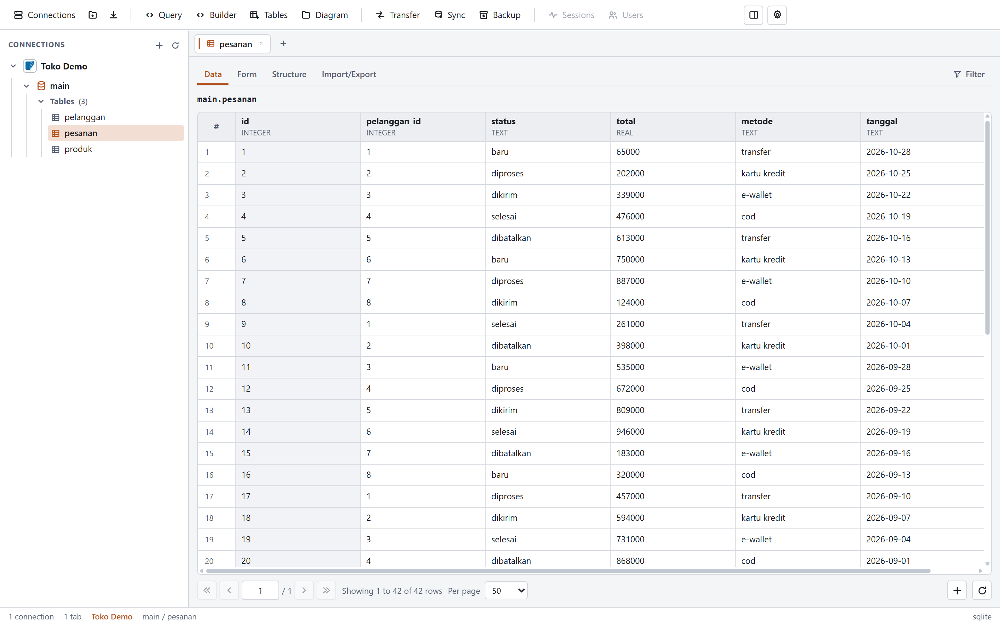

<div align="center">


# Tupai

### Satu aplikasi desktop untuk enam engine database.

**MySQL · MariaDB · PostgreSQL · Oracle · SQLite · MongoDB**

Jelajahi objek, edit data, tulis query, dan pindahkan data tanpa berpindah alat.

[](https://github.com/afifn/tupai/releases)
[](LICENSE)
[](https://github.com/afifn/tupai/releases)
[](https://www.electronjs.org/)

[Unduh](#memasang) · [Fitur](#fitur) · [Dukungan engine](#dukungan-engine) · [Mulai cepat](#mulai-cepat) · [Pembaruan](#pembaruan) · [FAQ](#faq) · [Lisensi](#lisensi)

</div>

> [!IMPORTANT]
> Unduh Tupai hanya dari [halaman rilis resmi](https://github.com/afifn/tupai/releases).
> Build macOS saat ini belum ditandatangani dan belum dinotarisasi, jadi macOS
> menolak pembukaan pertama sampai Anda membukanya lewat klik kanan → **Open**.
> Repositori dengan nama mirip atau README salinan tidak menjamin unduhan resmi.

---

<picture>
  <source media="(prefers-color-scheme: dark)" srcset="assets/screenshots/dark.png">
  
</picture>

---

Tupai menyatukan pekerjaan sehari-hari seorang pengguna database ke satu jendela:
membuka koneksi, menelusuri database dan schema, mengedit baris, menulis SQL,
membandingkan struktur, memindahkan data, dan membaca rencana query. Tidak ada
server perantara dan tidak ada akun cloud.

Semua operasi database berjalan di **worker thread** terpisah dari antarmuka.
Kredensial dienkripsi oleh penyimpanan aman OS dan tidak pernah dikirim balik ke
tampilan. Setiap channel IPC divalidasi sebelum menyentuh driver.

## Fitur

### Koneksi

- Enam engine: MySQL, MariaDB, PostgreSQL, Oracle, SQLite, dan MongoDB.
- Port serta opsi bawaan per engine; port mengikuti saat engine diganti.
- Grup koneksi dengan warna penanda dan drag & drop antar grup.
- SSH tunnel untuk MySQL/MariaDB dan PostgreSQL, dengan verifikasi host key.
- SSL/TLS dengan CA, client certificate, dan private key (MySQL/MariaDB,
  PostgreSQL).
- Tombol **Test** sebelum koneksi disimpan.
- Impor dan ekspor koneksi Navicat (`.ncx`). Password tidak pernah didekripsi
  atau ikut diekspor.

### Menjelajah objek

- Tree Database → Schema → Tabel/View, plus Routines (function, procedure,
  trigger, event) dan Saved queries.
- Kolom tampil di panel Detail, bukan memenuhi tree.
- Informasi tabel: jumlah baris, ukuran, komentar, dan engine.
- Pencarian cepat lintas objek yang sudah dimuat lewat `Mod+F`.
- Menu konteks untuk koneksi, database, schema, tabel, view, dan routine.
- Fokus sidebar mengikuti database/schema yang Anda klik, sehingga tab query
  baru selalu terbuka pada scope yang terlihat.

### Data

- Grid dengan paging, sorting, filter cepat, dan filter multi-kondisi (AND/OR).
- Edit sel sesuai tipe kolom, tambah baris inline, dan hapus banyak baris dalam
  satu transaksi.
- Preview BLOB: gambar, teks, atau hex dump.
- Form view untuk melihat satu record per halaman.
- Diagram tabel dan relasi (ER) dengan penyuntingan langsung.

### Query dan asisten

- Editor Monaco dengan autocomplete tabel/kolom, multi-tab, dan riwayat query.
- Batas baris ditegakkan di driver, jadi `SELECT *` pada tabel besar tidak
  memuat seluruh hasil ke memori.
- Hentikan query yang sedang berjalan (PostgreSQL, MySQL, Oracle).
- Area hasil berisi satu tab per statement, tab Messages, dan query plan
  (EXPLAIN).
- Jalankan seluruh isi editor atau hanya bagian yang dipilih.
- Transaksi manual (MySQL, MariaDB, PostgreSQL, Oracle): mulai transaksi,
  jalankan beberapa statement, lalu **Commit** atau **Rollback**. Menutup tab
  atau memutus koneksi akan menanyakan nasib transaksi.
- Beautify lokal dengan `sql-formatter`.
- Query Builder visual untuk SELECT.
- Asisten AI dengan endpoint OpenAI-compatible: streaming, tombol berhenti,
  rujukan tabel lewat `@nama_tabel`, dan aksi SQL (optimize, explain, komentar,
  konversi dialek).
- Jawaban `SELECT` menampilkan pratinjau maksimal lima baris; permintaan lebih
  dari lima baris hanya menampilkan query. Pratinjau bisa dimatikan di Setelan.
- Asisten selalu menerima konteks engine dan database yang terbuka, dan perannya
  dikunci ke urusan database.

### Struktur dan administrasi

- Table Designer: kolom, index, foreign key, komentar, info, dan DDL.
- View Designer.
- User dan permission (MySQL, MariaDB, PostgreSQL, Oracle).
- Monitor sesi dan hentikan sesi lain (semua engine kecuali SQLite).
- Import CSV dan SQL; ekspor CSV, JSON, dan SQL. Backup & restore SQL dengan
  riwayat.
- Data Transfer antar tabel, termasuk lintas engine, dengan pratinjau dan dry
  run.
- Sinkronisasi struktur dan data antar database dengan pratinjau diff sebelum
  deploy. Sinkronisasi data menolak tabel tanpa primary key.

### Antarmuka dan preferensi

- Menu aplikasi native yang mengikuti keymap tersimpan dan menonaktifkan item
  tanpa target.
- Setelan dengan delapan bagian: Umum, Tampilan, Editor, Grid, Oracle, Asisten,
  Keymap, dan Tentang.
- Lima tema: Terang, Gelap, Light Ocean, Dark Forest, dan Kustom. Palet kustom
  diturunkan dari empat warna inti dan divalidasi kontrasnya.
- Lima bahasa: English (utama), Bahasa Indonesia, 简体中文, 日本語, dan Español.
  Nama engine, `NULL`, `BLOB`, dan kata kunci SQL tidak diterjemahkan.
- Keymap yang bisa diubah untuk sepuluh aksi shell.
- Notifikasi hasil operasi di dalam aplikasi, dengan hitungan waktu yang
  berhenti saat kursor berada di atasnya.
- Pemeriksaan pembaruan saat aplikasi dibuka.

## Dukungan engine

Semua engine memiliki grid data, filter, dan penyuntingan sel. Kemampuan yang
berbeda per engine:

| Kemampuan          | MySQL | MariaDB | PostgreSQL | Oracle |  SQLite  | MongoDB |
| ------------------ | :---: | :-----: | :--------: | :----: | :------: | :-----: |
| SQL editor         |  Ya   |   Ya    |     Ya     |   Ya   |    Ya    |    —    |
| Struktur & DDL     |  Ya   |   Ya    |     Ya     |   Ya   | Terbatas |    —    |
| User & permission  |  Ya   |   Ya    |     Ya     |   Ya   |    —     |    —    |
| Monitor sesi       |  Ya   |   Ya    |     Ya     |   Ya   |    —     |   Ya    |
| Backup/restore SQL |  Ya   |   Ya    |     Ya     |   Ya   |    Ya    |    —    |
| Sinkronisasi       |  Ya   |   Ya    |     Ya     |   Ya   |    Ya    |    —    |
| Transaksi manual   |  Ya   |   Ya    |     Ya     |   Ya   |    —     |    —    |
| Diagram ER         |  Ya   |   Ya    |     Ya     |   Ya   |    Ya    |    —    |

- **MongoDB** adalah document store: tanpa SQL editor, DDL, sinkronisasi,
  backup SQL, atau manajemen user.
- **SQLite** tidak bisa `ALTER COLUMN` atau mengganti primary key. Perubahan
  seperti itu dilaporkan `unsupported`, bukan diterapkan diam-diam.
- Sinkronisasi data memerlukan primary key, termasuk primary key komposit.

## Memasang

### macOS

Unduh dari [halaman rilis](https://github.com/afifn/tupai/releases):

- `Tupai-<versi>-arm64.dmg` untuk Apple Silicon
- `Tupai-<versi>-x64.dmg` untuk Intel

Buka DMG, lalu seret Tupai ke Applications. Build belum ditandatangani, jadi
Gatekeeper menolak pembukaan pertama. Buka lewat klik kanan → **Open** sekali,
atau jalankan:

```bash
xattr -dr com.apple.quarantine /Applications/Tupai.app
```

### Windows

Unduh `Tupai-Setup-<versi>.exe` dari
[halaman rilis](https://github.com/afifn/tupai/releases), lalu jalankan.

Build belum ditandatangani secara digital, jadi Windows menampilkan peringatan
lebih dulu. Ini normal untuk aplikasi tanpa sertifikat code signing, bukan tanda
file rusak:

1. Jendela biru **"Windows protected your PC"** muncul.
2. Klik **More info** (teks kecil di bawah pesan).
3. Klik **Run anyway**.

Setelah itu installer berjalan seperti biasa. Windows meminta konfirmasi
administrator saat installer dijalankan, karena Tupai dipasang untuk semua
pengguna; setelah disetujui, folder pemasangan bisa diubah bila perlu.
Installer mengikuti bahasa Windows.

Koneksi yang sudah tersimpan tidak dihapus saat aplikasi dicopot, jadi memasang
ulang tidak menghilangkan daftar koneksi Anda.

### Dari sumber

Butuh Node.js 22.12+ (disarankan 24.x LTS) dan npm.

```bash
npm install
npm run rebuild
npm run dev
```

Membuat build macOS tanpa tanda tangan:

```bash
npm run dist:mac:unsigned
```

## Mulai cepat

1. **Buat koneksi.** Klik **Koneksi baru** di toolbar, pilih engine, lalu isi host,
   port, user, dan password. Untuk SQLite pilih file database. Tab SSL dan SSH
   opsional. Tekan **Test** sebelum menyimpan.
2. **Buka objek.** Klik dua kali koneksi di sidebar, bentangkan database dan
   schema, lalu klik nama tabel untuk membuka datanya.
3. **Jelajahi dan edit.** Gunakan paging, sorting, dan filter. Tambah baris lewat
   tombol di pager; pilih beberapa baris untuk menghapus sekaligus. Tabel tanpa
   primary key bersifat read-only.
4. **Tulis query.** Buka tab Query (`Mod+1`), pilih database dan schema di bar
   atas, lalu jalankan dengan `Mod+Enter`. Pilih sebagian teks untuk menjalankan
   bagian itu saja.
5. **Pakai asisten.** Buka panel asisten, lalu tanyakan soal skema atau data.
   Ketik `@` untuk merujuk tabel beserta kolomnya. Blok SQL di jawaban bisa
   disisipkan ke editor.
6. **Pindahkan atau cadangkan.** Gunakan **Transfer** untuk memindahkan data,
   **Sync** untuk menyamakan struktur/data, dan **Backup** untuk dump SQL.
7. **Atur aplikasi.** `Mod+,` membuka Setelan: bahasa, tema, font editor, ukuran
   grid, konfigurasi asisten, keymap, dan info versi.

### Pintasan

| Aksi              | macOS | Windows/Linux |
| ----------------- | ----- | ------------- |
| Tab query baru    | `⌘1`  | `Ctrl+1`      |
| Jalankan query    | `⌘↩`  | `Ctrl+Enter`  |
| Tutup tab         | `⌘W`  | `Ctrl+W`      |
| Cari objek        | `⌘F`  | `Ctrl+F`      |
| Buka Setelan      | `⌘,`  | `Ctrl+,`      |
| Buka tab Users    | `⌘2`  | `Ctrl+2`      |
| Buka tab Sessions | `⌘6`  | `Ctrl+6`      |

Semua pintasan bisa diubah di **Setelan → Keymap**.

## Pembaruan

Aplikasi memeriksa rilis baru saat dibuka dan menampilkan notifikasi bila ada
versi lebih baru. Pemeriksaan manual ada di **Setelan → Tentang → Periksa
pembaruan**, atau di menu aplikasi.

- **Windows** (bila build tersedia): pembaruan diunduh di latar belakang lalu
  dipasang saat Anda menekan **Pasang dan mulai ulang**.
- **macOS**: build belum ditandatangani, sehingga macOS tidak mengizinkan
  aplikasi mengganti dirinya sendiri. Panel menampilkan versi baru dan tombol
  **Buka halaman unduhan**; unduh DMG lalu pasang seperti biasa.

Saat memeriksa pembaruan, Tupai hanya mengirim permintaan versi ke GitHub.
Koneksi database, kredensial, dan setelan tidak pernah ikut.

## Kebutuhan sistem

- **macOS 13 atau lebih baru**, Apple Silicon atau Intel.
- **Windows 10/11 64-bit**: target build tersedia, installer publik belum
  diterbitkan.
- **Oracle**: server 12.1+ berjalan dengan mode thin. Server yang lebih lama
  memerlukan Oracle Instant Client dan mode thick, yang diatur di
  **Setelan → Oracle**.
- **MongoDB**: tanpa SQL editor, DDL, sinkronisasi, backup SQL, atau manajemen
  user.
- **SQLite**: tanpa manajemen user dan tanpa `ALTER COLUMN`/perubahan primary
  key.

## Data dan privasi

Semua data tersimpan lokal di folder data aplikasi. Lokasinya bisa dibuka dari
**Setelan → Tentang → Folder data**. Isinya antara lain koneksi, setelan, query
tersimpan, dan riwayat.

- Password database, passphrase SSH, dan API key AI dienkripsi dengan
  penyimpanan aman OS (`safeStorage`). Bila OS tidak menyediakannya,
  penyimpanan gagal dengan pesan jelas alih-alih menulis nilai kosong.
- Kredensial tidak pernah dikirim ke tampilan.
- Host key SSH diverifikasi: koneksi pertama dicatat, dan perubahan sidik jari
  memblokir koneksi sebelum autentikasi.
- Setelan bisa diekspor dan diimpor. API key tidak ikut karena tinggal di file
  terpisah di balik `safeStorage`.

## FAQ

<details>
<summary><strong>Apakah Tupai gratis?</strong></summary>

Ya. Kode dan build Tupai dirilis dengan lisensi [MIT](LICENSE). Tidak ada akun,
langganan, atau server yang perlu dijalankan.
</details>

<details>
<summary><strong>Apakah data database saya dikirim ke internet?</strong></summary>

Tidak. Semua koneksi dan operasi berjalan langsung dari komputer Anda. Satu-satunya
permintaan keluar adalah pemeriksaan versi saat aplikasi dibuka, dan permintaan
ke endpoint AI bila Anda mengaktifkan Asisten.
</details>

<details>
<summary><strong>Kenapa macOS menolak membuka Tupai?</strong></summary>

Build saat ini belum ditandatangani dan dinotarisasi. Buka lewat klik kanan →
**Open** sekali, atau jalankan `xattr -dr com.apple.quarantine /Applications/Tupai.app`.
</details>

<details>
<summary><strong>Apakah sudah ada build Windows?</strong></summary>

Belum. Target build Windows ada di repositori, tetapi installer belum
dipublikasikan. Rilis saat ini berisi build macOS arm64 dan x64.
</details>

<details>
<summary><strong>Engine mana yang mendukung transaksi manual?</strong></summary>

MySQL, MariaDB, PostgreSQL, dan Oracle. SQLite menjalankan setiap statement
langsung. MongoDB tidak memakai transaksi SQL.
</details>

<details>
<summary><strong>Apakah aman menyambung ke database produksi?</strong></summary>

Tupai bisa menyambung ke server mana pun yang kredensialnya Anda masukkan, tetapi
edit data, DDL, dan sinkronisasi langsung mengubah target. Uji dulu pada salinan
atau database pengembangan, dan pastikan backup tersedia. Tabel tanpa primary key
otomatis read-only.
</details>

<details>
<summary><strong>Di mana setelan dan koneksi disimpan?</strong></summary>

Di folder data aplikasi, yang bisa dibuka dari **Setelan → Tentang → Folder
data**. Tidak ada data yang disimpan di server.
</details>

<details>
<summary><strong>Bagaimana melaporkan bug atau meminta fitur?</strong></summary>

Buka [issue](https://github.com/afifn/tupai/issues) dengan versi Tupai, engine
dan versi server, langkah reproduksi, serta pesan error. Log dan lokasi folder
data ada di **Setelan → Tentang**.
</details>

## Changelog dan dokumentasi

- [CHANGELOG.md](CHANGELOG.md) — riwayat perubahan per rilis.
- [Halaman rilis](https://github.com/afifn/tupai/releases) — installer, ZIP, dan
  catatan rilis.
- [Issues](https://github.com/afifn/tupai/issues) — laporan bug dan permintaan
  fitur.
- [LICENSE](LICENSE) — teks lisensi MIT.

## Kontribusi

Issue dan pull request terbuka. Sebelum mengirim perubahan, jalankan:

```bash
npm run typecheck
npm run lint
npm test
```

Untuk perubahan yang menyentuh driver, IPC, atau sinkronisasi, jalankan juga
smoke test yang sesuai. Sertakan langkah verifikasi di deskripsi pull request.

## Lisensi

[MIT](LICENSE). Copyright (c) 2026 Tupai.

## Catatan penggunaan

Tupai adalah alat administrasi database. Perintah yang Anda jalankan, termasuk
`DROP`, `TRUNCATE`, perubahan struktur, dan sinkronisasi, berlaku langsung pada
database tujuan. Pastikan Anda berhak mengubah target tersebut dan memiliki
backup sebelum menjalankan operasi yang merusak.
